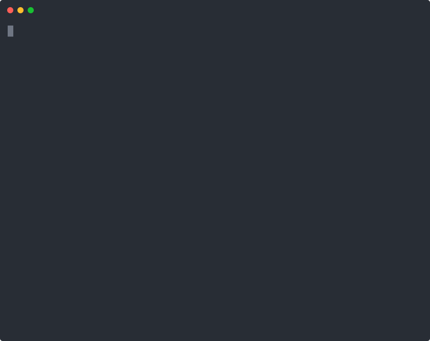

# Sistema de Transporte

Sistema de gestión para una empresa de micros de larga distancia, hecho en consola. Administra **terminales, rutas, micros y viajes**, ordena los despachos por prioridad y busca recorridos posibles entre dos ciudades con un tope de paradas. Todas las estructuras de datos (grafo, diccionarios, cola con prioridad, lista enlazada y más) son **TDA propios**, sin usar las colecciones de Java.

<p align="center">
  
</p>

> Trabajo práctico obligatorio de Programación II, UADE 2025. Java puro, sin dependencias.

**Probalo sin instalar nada:** el programa corre en el navegador desde el [portfolio](https://ivannavatta.github.io/#proyectos), en el caso *Sistema de transporte* → **Probar en vivo**.

## Funcionalidades

El programa arranca con datos de prueba: 10 terminales (BUE, COR, ROS, MDZ, SLA, TUC, SFE, NQN, BRC, POS), 15 micros (`AA-001-AA` a `EE-015-EE`), 9 rutas y 20 viajes planificados.

| Módulo | Opciones |
| --- | --- |
| **Micros** | Registrar un micro (patente y tipo: Cama, Semi-Cama o Ejecutivo) · micros con más asignaciones · micros operativos · porcentaje de utilización de la flota · reprogramar un viaje con otra fecha y otro micro |
| **Rutas** | Crear una ruta directa entre dos terminales con su distancia · reporte de las rutas más y menos recorridas |
| **Viajes** | Planificar un viaje sobre una ruta directa · cambiar su prioridad (1 alta, 2 media, 3 baja) · listar los viajes en orden de prioridad · buscar todos los recorridos entre dos terminales con un máximo de paradas (DFS) |
| **Terminales** | Registrar una terminal (código de 3 letras) · conectar terminales · listar las terminales operadas · terminales con más salidas y llegadas · terminales con más conexiones directas |

Las entradas inválidas (letras en lugar de números, terminales o patentes que no existen, rutas repetidas, origen igual a destino) muestran un error y el menú vuelve a preguntar.

## Cómo ejecutarlo

Requiere **Java 8 o superior** (JDK, para compilar).

```bash
git clone https://github.com/ivannavatta/-UADE-2025-PROGRA-II.git
cd -UADE-2025-PROGRA-II
javac -encoding UTF-8 -d out $(find src -name "*.java")
java -cp out Main
```

En Windows (PowerShell):

```powershell
javac -encoding UTF-8 -d out (Get-ChildItem -Recurse src -Filter *.java).FullName
java -cp out Main
```

También se puede abrir la carpeta con **IntelliJ IDEA** y correr `Main`.

Los datos viven en memoria mientras el programa está abierto: al salir se pierden y la próxima vez arranca con los datos de prueba.

## Estructura

```
src/
├── Main.java            Menú de consola y submenús de cada módulo
├── Controller/          SistemaController: la lógica de negocio y los reportes
├── Modulo/              Clases del dominio: Terminal, Ruta, Micro, Viaje
├── Interfaces/          Contratos de los TDA (GraphADT, PriorityQueueADT, …)
├── Implements/Dynamic/  Implementaciones dinámicas de los TDA y sus nodos
└── Exceptions/          Excepciones propias del dominio y de las estructuras
```

## TDA utilizados y justificación

### Grafo (`DynamicGraphADT`): mapa de rutas
Cada terminal es un vértice y cada ruta directa es una arista con peso (la distancia en km). Es la estructura natural para una red de transporte: permite verificar si dos terminales están conectadas (`existEdge`), contar las conexiones de cada una y detectar terminales aisladas. La búsqueda de recorridos es un **DFS con backtracking** que corta cuando se llega al máximo de paradas y no repite terminales dentro de un mismo camino.

### Diccionario simple (`DynamicSimpleDictionaryADT`): asignaciones por micro
Mapea `idMicro → cantidad de viajes asignados`. Dado el identificador de un micro, devuelve cuántas veces fue asignado: con eso se obtienen los micros operativos, los más asignados y el porcentaje de utilización de la flota.

### Diccionario múltiple (`DynamicMultipleDictionaryADT`): viajes por micro
Mapea `idMicro → [idViaje1, idViaje2, …]`. Un micro puede tener varios viajes, y una clave con varios valores es exactamente un diccionario múltiple. Permite recuperar el historial de viajes de un micro, cosa que un diccionario simple no puede.

### Cola con prioridad (`DynamicPriorityQueueADT`): orden de despacho
Ordena los viajes por prioridad (1 alta, 2 media, 3 baja) desde que se insertan. Cuando cambia la prioridad de un viaje (por ejemplo, por el clima), la cola se reconstruye para reflejar el nuevo orden sin romper el TDA.

### Lista enlazada (`DynamicLinkedListADT<T>`): registro de entidades
Cuatro listas guardan las terminales, los micros, las rutas y los viajes en orden de alta. La posición en la lista es el identificador de cada entidad, que es lo que usan como clave el grafo, los diccionarios y la cola.

El proyecto también implementa pila, cola, conjunto y árbol binario (`Implements/Dynamic/`); el grafo y los diccionarios usan conjuntos internamente.

## Decisiones de implementación

- **Los TDA guardan identificadores, no objetos.** Las firmas originales de los TDA trabajan con `int`; el controller traduce entre ids y objetos del dominio. Así los TDA no se modifican para cada caso de uso.
- **Prioridad por defecto.** Todo viaje nuevo entra con prioridad 2 (media).
- **Cambio de prioridad sin violar el TDA.** La cola con prioridad no expone una operación para modificar un elemento. Para cambiar una prioridad, el controller vacía la cola, reinserta cada viaje (el modificado con su nueva prioridad) y reemplaza la referencia.
- **Validaciones en los constructores.** Cada clase del dominio valida sus invariantes (ids negativos, textos vacíos, tipo de micro inválido, origen igual a destino) y lanza su propia excepción (`InvalidMicroException`, `InvalidTerminalException`, `InvalidRuteException`, `InvalididTravelException`), así el error dice exactamente qué falló.

## Autor

- [Ivan Navatta](https://github.com/ivannavatta)
